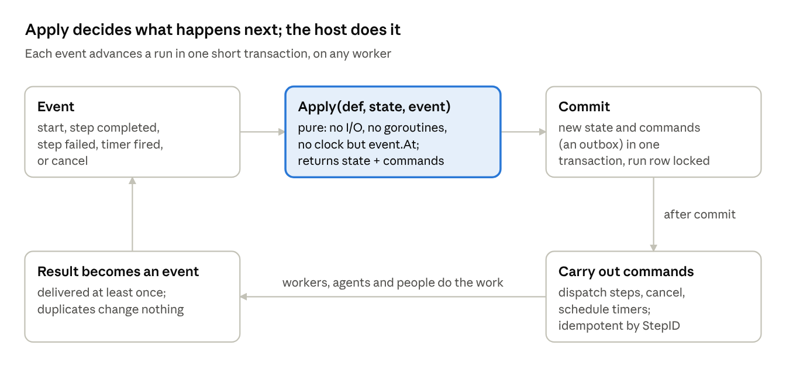

# workflow: a pure progression engine

Oct 28, 2026 · Curtis Myzie

The `workflow` Go library is now one pure function, `Apply(def, state, event) → (state, commands)`, plus hosts that run it in-process or on Postgres. A run is a row, not a process: any worker can advance it, and it can wait days for a person or an agent. Definitions are typed, so mistakes surface at validation rather than hours into a run. It is for services that already run durable jobs and use only the core package, and for programs that want a ready Postgres host. This is a prototype on a branch, and we would like your feedback before it settles.

## What changed

The engine no longer runs workflows; it computes what should happen next. Everything that touches the outside world moved to a host, and the library ships two.

|  | Before | Now |
| --- | --- | --- |
| Engine | An executor that ran a workflow in-process, one goroutine per branch | `Apply`: a pure function from state and one event to new state and commands. No I/O, goroutines or clock |
| Where a run lives | In the process running it, with checkpoints to resume | In a row. Each event advances it in one short transaction, on any worker |
| Persistence | Interfaces to implement (`Checkpointer`, `StepProgressStore`, `ActivityLogger`, `SignalStore`) | The `State` is plain JSON. A Postgres host is included |
| Step execution | A registry of Go activities | Commands (`DispatchStep`) the host carries out. Kinds such as `agent` or `action` belong to the host |
| Waiting on people or other systems | Signals, pause, durable sleep | A step whose result is delivered later, any time; `sleep` and `timeout` become timer commands |
| Expressions | Pluggable script engine, untyped | expr, type-checked against JSON Schemas at validation, and enforced at run time |
| Routing | Conditional edges | `switch` on a value (checked against its enum) and boolean `when` edges |
| Joins | Wait for named branches | Fire when no live path can still reach them, so completion order never matters |

The change is large: about 35,000 lines removed and 10,000 added, including tests and docs. There is no compatibility layer.

## At a glance



Apply only decides. Everything that touches the outside world happens in the host, after the commit, and comes back as an event.

## The core API

The whole engine is one call:

```go
next, commands, err := workflow.Apply(def, state, event)
```

An event is one of five things: the run started, a step completed, a step failed, a timer fired, or the run was cancelled. `Event.At` is the only clock Apply reads, so the same state and event always give the same result. Apply never modifies the state it is given.

A command is what the host must do: `DispatchStep` (run a step attempt, not before `NotBefore`), `CancelStep`, `ScheduleTimer`, and `RunCompleted`, `RunFailed` or `RunCancelled`.

Every unit of work has a stable, readable `StepID`, such as `main/verify[3]#1`: path `main`, step `verify`, item 3, attempt 1. Hosts use it as the idempotency key for the work they create.

A host drives a run like this:

```go
def, _ := workflow.Load(doc, workflow.KindMap{"agent": nil, "action": nil})

st, cmds, _ := workflow.Apply(def, nil, workflow.Event{
    At: now, Kind: workflow.EventStart, Inputs: map[string]any{"user": "u_123"},
})
// In one transaction: store st, and store cmds as an outbox.
// After commit, carry out cmds. Each result comes back as an event:

st, cmds, _ = workflow.Apply(def, st, workflow.Event{
    At: now, Kind: workflow.EventStepCompleted,
    StepID: "main/lookup#1", Output: map[string]any{"email": "ada@example.com"},
})
```

**The host contract.** A host that follows these five rules gets exactly-once progression from at-least-once delivery:

1. **Persist atomically.** Store the new state and the commands in the same transaction as the event, with the run row locked.
2. **Act after commit.** Carry out commands only after the transaction commits.
3. **Deliver at least once.** Report every result as an event and retry until it is applied. Duplicates and late results are ignored.
4. **Run each attempt idempotently.** Key side effects on the StepID, since a dispatch can be carried out twice.
5. **Keep the definition.** A state records its definition's hash, and Apply refuses another. A run keeps the version it started with.

**What Apply guarantees in return:** completions applied in any order reach the same final state; nothing that settled is dispatched again; a step retries only if it declares `retry` and the error is retryable; cancellation cancels everything in flight. A property test checks order independence over 200 shuffled orders of a real workflow and 40 orders each of 60 random graphs.

## Definitions

A definition is data: JSON, or YAML the host decodes and passes to `LoadMap`. Assistants can write it, people can edit it, a UI can draw it, and a run can resume months later on another build. This one reviews a pull request:

```yaml
name: Review pull request
schemas:
  findings: {type: object, required: [items], properties: {items: {type: array, items: {type: string}}}}
  verdict:  {type: object, required: [finding, confirmed],
             properties: {finding: {type: string}, confirmed: {type: boolean}}}
  # review and github_pull_request omitted here
event_schema: github_pull_request
steps:
  - name: pending
    action: github.commit.set_status        # a host kind; the host decides what it means
    with: {sha: '${{ event.pull_request.head.sha }}', state: pending}
    next: [correctness, tests]              # two edges: the path forks

  - {name: correctness, agent: reviewer, model: claude-opus-5-5,  output: findings, next: [gather]}
  - {name: tests,       agent: reviewer, model: claude-haiku-5-5, output: findings, next: [gather]}

  - name: gather
    join: [correctness, tests]              # wait for both
    next: [verify]

  - name: verify
    each: 'concat(correctness.items, tests.items)'   # one dispatch per finding
    concurrency: 4
    agent: reviewer
    output: verdict
    with: {finding: '${{ item }}'}
    retry: {max_attempts: 3, backoff: 10s, errors: [rate_limited]}
    match: first
    next:
      - {step: report, when: 'any(verify, it.confirmed)'}
      - {step: approve}

  - {name: report, agent: reviewer, output: review, next: [post]}
  - {name: approve, set: {verdict: APPROVE, body: No confirmed findings.}, next: [post]}

  - name: post
    action: github.pull_request.create_review
    with: {event: '${{ coalesce(report, approve).verdict }}'}   # whichever ran

on_failure:
  - {name: errored, action: github.commit.set_status, with: {state: error, description: '${{ error.message }}'}}
```

Values in `with:`, `set:` and `outputs` are templates, written `${{ expr }}` as in GitHub Actions. A value that is exactly one template keeps the expression's type, so `${{ correctness.items }}` stays a list. Only `${{ }}` is a template: shell `${HOME}` and JavaScript template literals pass through as text.

- **Kinds.** Each step has one kind key. `join`, `set` and `sleep` belong to the library; every other key (`agent`, `action`) is a host kind. Everything about a host kind except `with:` goes to the host unevaluated, in `Command.Config`.
- **Paths.** When several edges match, the path forks. A join fires when no live path can still reach it, then merges what arrived.
- **`each`** runs one dispatch per item, up to `concurrency` at a time. Its value is the list of item outputs, in item order.
- **Failure.** Nothing retries unless it declares `retry`. `catch` routes a failure to another step, which reads the error from the failed step's value. Otherwise the run fails, everything in flight is cancelled, and `on_failure` runs.
- **`timeout`, `sleep` and `max_visits`** cover deadlines, waits and loop bounds. Every cycle must have a bound.

Routing on a value uses `switch` instead of a chain of conditions:

```yaml
- name: classify
  agent: triager
  output: triage                  # kind: bug | feature | question
  next:
    switch: classify.kind
    cases: {bug: reproduce, feature: spec, question: answer}
```

## Typed definitions

`Load` type-checks every expression and parameter block before anything runs. Types come from JSON Schemas: each step's `output:`, the `inputs`, the trigger's `event_schema`, and schemas the host supplies for its tools. Steps without a schema stay unchecked, so typing can be added gradually.

These are four single mistakes in a triage workflow (the classify step above, three handlers, and a step that comments on the issue), and what `Load` reports (from `examples/typed`):

```
classify.summary -> classify.sumary
  step comment: with: `classify.sumary`: no field "sumary" in
    {kind: "bug" | "feature" | "question", summary: string} (did you mean "summary"?)

"feature": "spec" -> "feture": "spec"
  step classify: next: case "feture": classify.kind is never "feture" (it is one of bug, feature, question)
  step classify: next: switch on classify.kind does not handle feature; add cases or a default

coalesce(reproduce, spec, answer).body -> reproduce.body
  step comment: with: `reproduce`: may be nil here; use ?. or try(...)

"issue": "${{ event.issue.number }}" -> "issue": "${{ event.issue.title }}"
  step comment: with.issue: string is not integer
```

- **Maybe-nil reads.** Validation works out from the graph which steps are certain to have run before each step. Reading a step that might not have run needs `?.` or `coalesce`. The checker knows `coalesce(reproduce, spec, answer)` is never nil, because one of the three alternatives must have run.
- **Routing.** A `switch` must handle every value of its enum or have a `default`. A `when` must be a boolean, so `when: verify` (a list) is an error.
- **The promise.** If a definition validates and every step's output matches its schema, no expression fails at run time on a missing field, a nil, or a wrong type. Two independent reviews set out to break this promise and found 15 ways to do it. Each is fixed and is now a regression test, so the promise is checked on every build.
- **Run time.** Apply enforces the same schemas. Inputs and the trigger are checked at start, parameters before dispatch (the host never sees a bad call), and outputs on completion. `Command.OutputSchema` carries the schema, so a host can ask a model for exactly that shape.

A host that knows its tools implements one optional method, and `with:` blocks are then checked against each tool's parameters:

```go
func (k hostKinds) Schemas(kind string, cfg map[string]any) (params, output *workflow.Schema, err error) {
    if kind == "action" {
        tool := k.tools[cfg["action"].(string)]   // e.g. github.comment
        return tool.InputSchema, tool.OutputSchema, nil
    }
    return nil, nil, nil
}
```

The type checker lives in the expr library as `Program.Check`, so the checker and the evaluator read the same syntax, and other expr users get it too.

## Running it

Most hosts never call `Apply` themselves. Two hosts ship with the library.

**In-process** (`local`), for tests, CLIs and single-process programs. Handlers are Go functions keyed by kind:

```go
r := &local.Runner{Handlers: map[string]local.Handler{
    "agent": func(ctx context.Context, c workflow.Command) (any, error) {
        return runAgentTurn(ctx, c.Config["agent"], c.Params)
    },
}}
st, err := r.Run(ctx, def, inputs, trigger)   // st.Status, st.Outputs, st.Error
```

Return a `*workflow.StepError` to set the error type and whether it is retryable. `Save` and `Resume` give crash recovery from the saved state.

**Postgres** (`postgres`, a separate module on pgx). It keeps definitions by hash, run state in jsonb, a record per step attempt, an event log, and an outbox of jobs. Workers claim jobs with `SKIP LOCKED`, hold leases with heartbeats, and fence out late results from workers that lost their lease.

```go
store, _ := postgres.New(pool, kinds)
_ = store.Migrate(ctx)

_, _ = store.Start(ctx, postgres.NewRun{
    ID: "deploy-1.4.0", Definition: def, Input: map[string]any{"version": "1.4.0"},
})

w := &postgres.Worker{Store: store, Handlers: map[string]postgres.Handler{
    "action": runAction,
    "approval": func(ctx context.Context, job postgres.Job) (any, error) {
        notifyApprovers(job.StepID, job.Params)   // email, Slack, a page in the app
        return nil, postgres.ErrDeferred      // the result arrives later
    },
}}
go w.Run(ctx)
```

A step that returns `ErrDeferred` stays in flight with no worker holding it, for minutes or days. When the person decides, the application delivers the result in its own transaction, for example from an HTTP handler. Delivering it twice is safe:

```go
store.Deliver(ctx, "deploy-1.4.0", workflow.Event{
    Kind: workflow.EventStepCompleted, StepID: "main/approve#1",
    Output: map[string]any{"approved": true, "by": "grace"},
})
```

`StartTx` and `DeliverTx` take the caller's transaction, so starting a run or recording a result can commit atomically with the application's own writes. A host with its own durable job system can skip both hosts and map commands onto its jobs.

Runnable examples: `examples/apply` (Apply by hand), `examples/typed`, `examples/retry` (retry, timeout, catch, `on_failure`) and `postgres/examples/approval`.

## Not in this version

- **Signals and operator pause.** Waiting on the outside world is a deferred step delivered later. There is no way yet to pause a run by hand.
- **Child workflows.** A step cannot start another workflow and wait for it, except through a host kind that does so.
- **Run queries.** The Postgres store reads one run, its steps and its events. Listing and filtering runs is not built yet.
- **Other stores and expression engines.** SQLite and the pluggable script engine are gone; expressions are expr only.
- **Backoff jitter.** Apply cannot use randomness, so backoff is exact. A host may add jitter when it schedules, since later is always safe.
- **A migration path.** The old API is removed, with no compatibility layer.

## Questions for you

1. **The boundary.** Would you run one of the included hosts, or map commands onto a job system you already have? What would you need from the library to do the second?
2. **Strict types.** Expressions may read only the properties a schema declares, which is what catches typos. Is declaring what you read acceptable, or too much friction?
3. **Maybe-nil.** Reading a step that might not have run needs `?.` or `coalesce`. Would you rather the engine infer joins from which steps read which?
4. **Step names.** Steps are bare names in expressions (`classify.kind`), so a step cannot be called `first`, `count` or `split`. Would a `steps.` prefix be worth the longer expressions?
5. **Invalid output.** An output that does not match its schema fails the step without retry, since retrying an action could repeat its side effects. An agent host that wants retries validates the output itself. Is that the right default?
6. **What is missing** for the workflows you would run: signals, pause, child workflows, run listing, or something else?
